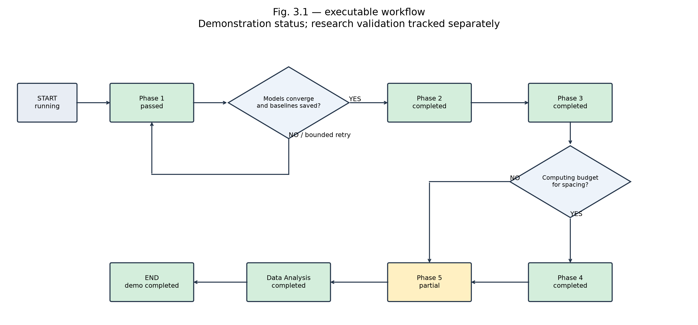
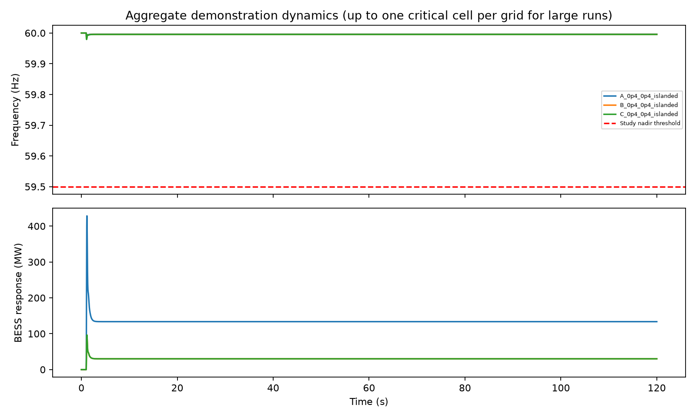

# Section 3.8 — Python / pandapower and MATLAB / Simulink system

**New complete experiment controller:** [experiment_38.py](experiment_38.py). Read [SECTION_3_8.md](SECTION_3_8.md) for the entire system flow, phase-by-phase code map, research data contract, and diagrams. The files described below also retain the earlier aggregate Fig. 3.1 prototype.

Run all five stages on the three benchmark cells:

```powershell
.\.venv\Scripts\python experiment_38.py --quick --output my_first_run
```

Omit `--quick` to exercise all 50 cells. The complete controller adds real-coded NSGA-II, MOPSO, archived annealing, site/share/ratio enumeration, six-group decomposition, matched-capacity spacing, all eleven sensitivity-case registrations, cap analysis and an append-only evaluation audit. Walkthrough settings reduce computation and use partial demo physics. Research mode requires calibrated models and does not fabricate missing metrics.

Source: **Updated Chapter 3.pdf**, PDF pages 25–26, Fig. 3.1, with phase descriptions in Section 3.8. The original embedded figure is in [reference/X665.png](reference/X665.png).

This project implements the overall flowchart and supplies an executable **demonstration**, plus a MATLAB research-stage coordinator. Its output is not a calibrated study, a replacement-ratio recommendation, or proof that all ten research constraints pass.

## Run

Python 3.11+ is recommended. Use an isolated environment:

```powershell
cd C:\abacus
python -m venv .venv
.\.venv\Scripts\python -m pip install -r requirements.txt
.\.venv\Scripts\python system.py --spacing
.\.venv\Scripts\python visualize_flow.py
```

Omit `--spacing` to exercise the flowchart's NO computing-budget branch. Add `--full-matrix` to run the 50 demo cells rather than three representative cells. `--ratio-points 9` controls the coarse sampled ratio search on [0, 2]. Re-run each experiment into a fresh folder, e.g. `--output results_no_spacing`, to keep its artifacts separate.

For actual Simulink execution of each dynamic evaluation (requires MATLAB and Simulink on PATH):

```powershell
.\.venv\Scripts\python system.py --backend simulink --output results_simulink
```

MATLAB starts once per dynamic evaluation with this simple file bridge, so this option is substantially slower. The default Python backend uses the same differential equations for quick demonstration. File exchange is JSON inputs and CSV outputs; no MATLAB Engine Python package is required.

To build and inspect the real connected Simulink block model independently:

```matlab
addpath('C:/abacus/matlab');
run_case('C:/abacus/results/dynamic_input.json', ...
         'C:/abacus/results/simulink_trace.csv');
open_system('C:/abacus/matlab/fig31_frequency_demo.slx');
```

The generated SLX contains a contingency Step, power-balance Sum, swing-equation inertia Gain and Integrator, governor droop and response, GFM droop, BESS power Saturation and response, frequency Scope, and logged frequency/power signals. Parameters persist in the model workspace after `run_case`. `build_model` alone creates the structure; use `run_case` to populate parameters and simulate it.

## Flow and artifacts



| Figure stage | Implemented behavior | Output |
|---|---|---|
| Phase 1 | Three consistently scaled IEEE39 networks; convergence gate and up to three retries; save baselines | `baseline_A/B/C.json` |
| Phase 2 | Five demo site configurations per grid; coarse ratio searches; reference selected with 2% rule | `screening.json` |
| Phase 3 | Three or 50 cells; sampled ratio search; fixed-site group diagnostics | `surface.json` |
| Computing-time decision | Explicit run/skip switch | `workflow.json` |
| Phase 4 | Free-capacity site-count sweep and matched total MW / one-hour MWh comparison | `spacing.json` when enabled |
| Phase 5 | Three virtual-inertia sensitivity examples; explicit unvalidated EMT status | `validation.json` |
| Data analysis | Capacity ratios, frequency responses, per-evaluation audit | PNG charts, CSV traces, `evaluations.json`, `summary.json` |



`research_feasible` is always false in demo evaluations. `demo_pass` only means the implemented demonstration checks pass. Static-screen failures consume an evaluation but do not run a dynamic solver. The summary counts dynamic candidate evaluations separately from nominal evaluations; additional sensitivity runs are not included in that counter.

Group diagnostics test sampled monotonicity before using bisection at ratio tolerance 0.001; nonmonotone sampled behavior uses a 0.01 grid. Sampling does not prove mathematical monotonicity. STAB remains unavailable; the plotted partial binding group and partial lower bound exclude it. They are not the study's six-group decomposition. A maximum of individual minima need not be jointly feasible when a group is nonmonotone; the selected candidate must still be evaluated jointly.

## Demonstration equations and assumptions

The dynamic state is frequency deviation `df` in Hz, governor output `pg` in load-base pu, and BESS output `pb` in load-base pu:

```
M = 2*(Hsg + Hvirtual*BESS_MW/load_MW)/60
d(df)/dt = (pg + pb - loss_pu - D*df)/M
d(pg)/dt = (-Kg*df - pg)/Tg
d(pb)/dt = (clip(-Kb*BESS_MW/load_MW*df, +/-BESS_MW/load_MW) - pb)/Tb
```

Frequency starts at 60 Hz; the loss occurs at 1 s; simulation lasts 120 s. RoCoF uses a 500 ms finite difference; settling frequency is averaged over 110–120 s. Thresholds copied as study parameters: nadir 59.5 Hz, RoCoF 1 Hz/s, settling band 59.7–60.3 Hz, voltage deviation 0.05 pu, reserve 4% of load. These are not asserted to be current regulatory requirements.

## Verification

The saved three-cell run includes 198 candidate evaluations and the spacing branch. `results/verification.json` records the artifact and matched-capacity checks and MATLAB/Python equation comparison. The maximum frequency discrepancy in the reference case was 3.8e-10 Hz. MATLAB's `test_workflow` also passed baseline-retry, spacing YES/NO, and failed-validation gate tests. MATLAB syntax analysis found only history-array preallocation suggestions in the coordinator.

The 50-cell run is saved separately in `results_matrix`, with Phase 4 skipped. Its grid/state cell counts and energy-feasible cell selection were checked. The [ratio matrix](results_matrix/ratio_matrix.png) visualizes RE versus displacement for the five grid/state combinations. Blank squares mean untested or no passing demonstration candidate; they do not prove physical infeasibility.

Recheck saved outputs with `.\.venv\Scripts\python verify_outputs.py`. In MATLAB run `addpath('C:/abacus/matlab'); test_workflow`. These checks do not validate a physical grid model or execute Simulink.

Table 3.2 load/largest-loss/import values used: A = 14016/668/0 MW; B = 2681/150/89 MW; C = 2577/150/23 MW. Electrical scaling preserves base per-unit impedances; it is not the chapter's machine-by-machine calibration. RE is distributed proportionally to loads. HVDC is a constant injection at bus 39 with no inertia. A is islanded only; B/C support both states. The full matrix uses the ten combinations with displacement <= RE per state.

Demo limitations that materially affect results:

- Retains the IEEE39 reference machine roster rather than removing G1 and retiring physical units. Redispatch and inertia reduction are aggregate assumptions. Ratio denominator is `load * displacement`, not actual retired SG capacity.
- Uses voltage-ranked candidate buses and index-separated configurations, not short-circuit/participation screening or electrical-distance dispersion classes. Site location has no effect on aggregate dynamics, so it cannot establish spatial sensitivity or nodal frequency spread.
- Uses sampled search, not RNSGA-II, MOPSO, AMOSA, complete enumeration, three-seed experiments, or 2000-evaluation runs.
- Q checks only steady-state voltage; it does not verify dynamic reactive capability. No g5, g7, g8 or g9 implementation, multimachine eigenvalue/damping analysis, rotor-angle fault test, or converter-assisted gSCR. Consequently no all-ten-constraint feasibility result is possible.
- No battery SoC, one-hour energy enforcement, converter current dynamics, secondary regulation controller, switching model, or EMT validation. Matched MWh is a bookkeeping quantity. Three inertia examples are not the chapter's eleven sensitivity cases.
- No pre-retirement RE baseline suite, published IEEE39 solution cross-check, small-signal boundary sweep, or full reference-configuration enumeration.

## Connect the calibrated research models

`matlab/run_study.m` implements Fig. 3.1 with stage function handles and a validation gate. Supply phase functions with a common context struct. Phase 1 returns `models_converged` and `baselines_saved`; Phase 5 returns `validation_passed`. The coordinator retries the baseline gate, respects the optional Phase 4 branch, and prevents reporting successful research completion when validation has not passed.

Replace `prepare` with the calibrated bus/machine/retirement data, `dynamic_backend` with the validated multimachine Simulink RMS model, and `metrics` with all ten constraints. Then replace the demo search with the specified optimization/enumeration and add fault, short-circuit, nodal-frequency and EMT adapters. Required inputs include machine ratings/inertias/governors/exciters, GFM controls/current limits, RE placement, retirement mapping, fault location/timing, short-circuit parameters and validated switching models. These should be supplied or calibrated; this project does not invent them from the overall flowchart.

Official API references: [pandapower static generators](https://pandapower.readthedocs.io/en/stable/elements/sgen.html), [MATLAB programmatic model editing](https://www.mathworks.com/help/simulink/programmatic-modeling.html).

## Environment note

The local MATLAB release is R2025b Update 1; the chapter names R2026b. A Simulink license is reported, but this MATLAB installation contains only partial Simulink tooling: `bdIsLoaded` and `sim` cannot execute. Consequently the Simulink builder and backend are supplied but **have not been executed successfully**, and no verified SLX is included. Install the full Simulink product to generate it. `simulate_matlab.m` provides a MATLAB-only ODE reference for numerical comparison; this is not a Simulink execution test.

Demo generator and external-grid voltage targets are explicitly set to 0.99 pu, since the original IEEE39 case includes generator setpoints above the chapter's 1.05 pu ceiling and line charging raises voltages at reduced SG dispatch. This changes the demo operating point and is not a calibrated AVR setting.

An isolated `.venv` is included locally and should be used for this project. The initial global installation exposed a conflict with PyPSA; the original shared pandas 3.0.6 and NumPy 2.5.3 versions were restored. The project environment contains pandapower's compatible dependencies. The downloadable ZIP omits `.venv`; recreate it with the setup commands above.
