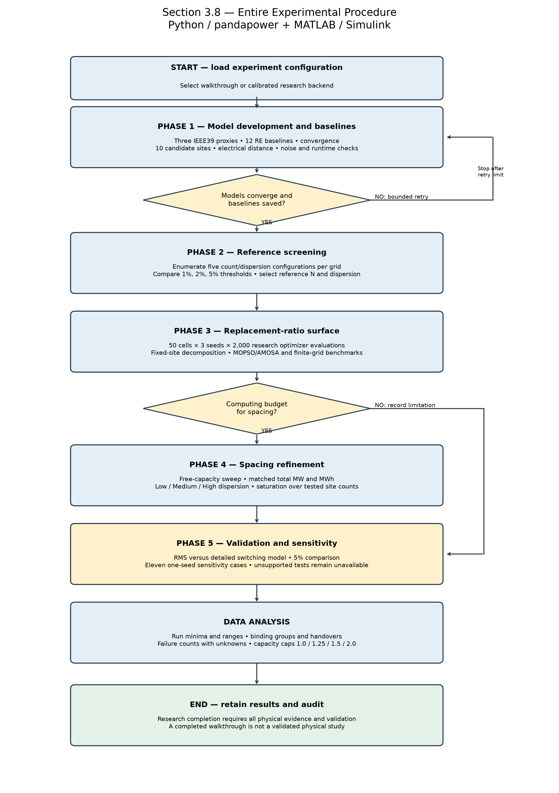
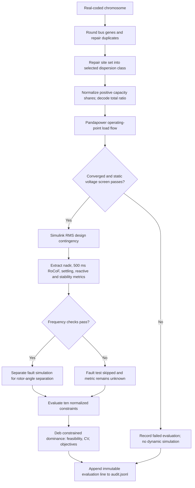

# Entire system flow for Section 3.8

The main system is **`experiment_38.py`**. It coordinates all five experimental phases, the optional spacing branch, and final analysis. `system.py` remains available as the earlier, simpler Fig. 3.1 demonstration.

The complete experiment software flow is implemented. The physical models remain a separate boundary: the included walkthrough uses aggregate demonstration dynamics, while research mode requires calibrated pandapower snapshots and validated Simulink RMS/fault/EMT functions. Missing measurements never become passing research constraints.



## Start the whole system

```powershell
cd C:\abacus
.\.venv\Scripts\python experiment_38.py --quick --output my_first_run
```

This executes all five phases on the three islanded RE = displacement = 60% benchmark cells. It also runs all reference-screening configurations and registers all eleven sensitivity cases. Unsupported physical tests are reported as unavailable.

For the complete 50-cell walkthrough:

```powershell
.\.venv\Scripts\python experiment_38.py --output my_50_cell_run
```

Each output directory must be fresh: this protects the per-evaluation audit from mixing separate experiments. The walkthrough uses one seed, 16 evaluations per optimization, two site sets per enumeration class and equal-share enumeration to keep it practical. These reductions are not the research protocol.

For research configuration:

```powershell
.\.venv\Scripts\python make_research_config.py
# Edit configs/research.json: set calibration_manifest and confirm assumptions.
.\.venv\Scripts\python experiment_38.py --config configs/research.json
```

Research mode requires three seeds and 2,000 evaluations per optimizer run across 50 core cells. It refuses reduced research settings. It also refuses to start without a calibration manifest. Do not use a walkthrough result as a replacement-ratio recommendation.

## Main control flow

```mermaid
flowchart TD
    A([START]) --> B[Read configuration and select physical backend]
    B --> C[Phase 1: build or load calibrated IEEE39 proxies]
    C --> C1[12 pre-retirement RE baselines with SG retained]
    C1 --> C2[Candidate-site screening, electrical distances, dispersion classes]
    C2 --> C3[Frequency-noise decision and runtime measurement]
    C3 --> D{Models converge and baselines saved?}
    D -- No, retries remain --> C
    D -- No, retry limit --> X[Stop with failed gate and audit]
    D -- Yes --> E[Phase 2: reference screening]
    E --> E1[Enumerate N=1; N=3 and N=5 Medium; N=3 Low and High]
    E1 --> E2[Apply 1%, 2%, 5% comparison; select reference N and dispersion]
    E2 --> F[Phase 3: 50 energy-feasible grid/state/RE/displacement cells]
    F --> F1[Three seeded RNSGA-II runs per cell]
    F1 --> F2[Select lowest-ratio feasible returned design]
    F2 --> F3[Fix sites and shares; decompose six constraint groups]
    F3 --> F4[Three benchmark cells: finite enumeration, MOPSO and AMOSA]
    F4 --> G{Run spacing within computing budget?}
    G -- Yes --> H[Phase 4: free-capacity site-count sweep]
    H --> H1[Matched total MW/MWh sweep across dispersion classes]
    H1 --> H2[Compute saturation over tested site counts]
    G -- No --> I[Record spacing limitation]
    H2 --> J[Phase 5: critical-cell validation]
    I --> J
    J --> J1[RMS versus detailed switching model comparison]
    J1 --> J2[Eleven sensitivity cases, one seed each]
    J2 --> K[Data analysis: binding groups, handovers, failure counts, tested limits]
    K --> K1[Capacity-cap post-processing: 1.0, 1.25, 1.5, 2.0]
    K1 --> L{Research evidence complete and validation passed?}
    L -- Yes --> M([Validated experiment complete])
    L -- No --> N([Walkthrough or partial experiment complete; validation pending])
```



## Shared evaluation used by every search



The chromosome has `2*N + 1` genes: N bus genes, N share genes, and one ratio gene. Objectives are replacement ratio and measured nodal-frequency spread. Frequency spread is demoted to a diagnostic when Phase 1 cannot distinguish it from numerical noise. The demo is aggregate, so it has no nodal spread objective.

## Files and responsibilities

| File | What it implements |
|---|---|
| `experiment_38.py` | Main controller, phases 1–5, chromosome repair, finite-grid enumeration, decomposition, analysis and JSONL audit |
| `optimizers.py` | Real-coded NSGA-II with SBX/polynomial mutation; archive MOPSO with 0.9→0.4 inertia; constrained single-chain archived annealing adaptation |
| `study_backend.py` | Pandapower operating points, electrical-distance calculation, ten-constraint residuals, demo and calibrated research adapters |
| `configs/walkthrough.json` | Runnable demonstration settings, assumptions, thresholds and synthetic 24-hour profiles |
| `configs/research.json` | Full-budget settings; calibrated manifest required |
| `configs/calibration_manifest.example.json` | Generated schema example for the model/data interface; not calibrated data |
| `matlab/evaluate_research.m` | Calls calibrated RMS, fault and detailed-switching MATLAB functions; gates fault runs on frequency checks |
| `matlab/build_model.m`, `run_case.m` | Earlier aggregate Simulink demonstration builder and runner |
| `matlab/run_study.m` | Standalone MATLAB phase coordinator with retry/validation gates |
| `test_section38.py` | Optimizer semantics, budget, reproducibility, constraints and repair tests |

## What each phase saves

**Phase 1 — Model development and baseline characterization.** Saves twelve RE baselines (four per grid), convergence results, model timing, ten candidate sites per grid and the frequency-spread objective decision. Demo ranking uses voltage deviation only. Research ranking combines supplied short-circuit and participation-factor evidence, normalized with equal weights. DC effective-reactance distances are calculated from the solved active-branch susceptance Laplacian pseudoinverse. Ranked mean pairwise distances are partitioned into Low/Medium/High terciles. Confirm these explicit implementation choices against the final electrical-distance and site-screening definitions before research use. Research snapshots must already contain the calibrated G1 removal and physical SG roster; the controller verifies required metadata and re-runs power flow rather than inventing generator ratings/inertias.

**Phase 2 — Reference screening.** Performs the five specified comparisons on the islanded 40/40 cell for each grid. The finite grid covers allowed site sets, positive capacity shares and configured ratios. Less than the threshold variation with all five configurations passing selects N=3/Medium; otherwise the largest returned requirement selects the conservative reference. Results at 1%, 2% and 5% are retained. A missing configuration cannot establish spatial insensitivity. A finite grid is only optimal on that grid, not over a continuous domain. Research enumeration can be very large; its resolution is explicit in the configuration.

**Phase 3 — Ratio surface.** Generates 10 A/islanded cells and 20 each for B/C, following Table 3.3. Each core cell uses deterministic SHA-256-derived seeds shared across algorithms. Per-run minima, ranges and site-agreement counts are saved; no mean/standard deviation is reported for three seeds. The selected configuration is fixed during decomposition. FFR/RoCoF/PR/Q/REG use sampled monotonicity followed by bisection to 0.001; nonmonotone cases use a grid. STAB always uses the 0.01 grid. Missing groups remain unmeasured. The joint selected design is still required to pass: a maximum of isolated minima cannot itself prove joint feasibility for nonmonotone constraints. MOPSO/AMOSA benchmark results are compared to explicitly discretized enumeration at the three islanded 60/60 cells.

**Phase 4 — Spacing refinement.** Chooses the largest-ratio cell per grid, breaking ties by lowest measured gSCR. Runs a free-capacity sweep over N={1,2,3,5}, then keeps ratio/retired MW and duration constant while changing placement. Both total MW and total MWh invariants are checked. Saturation is the first tested adjacent site-count improvement in [0,2%); a worsening result does not count as saturation. Strength/spread/local-RoCoF-spread saturation is also computed separately by dispersion class where measurements exist, using the best measured metric among tested placements at each site count. Zero/noise-level baselines do not establish saturation. The matched-capacity comparison uses equal shares; alternative share policies must be configured/implemented explicitly. Results remain separate from the core surface. The walkthrough cannot establish a physical spatial effect because its dynamics are aggregate.

**Phase 5 — Validation and sensitivity.** Calls the calibrated detailed-switching adapter and compares frequency nadir and RoCoF with a 5% relative tolerance and a site-set check. The detailed adapter must perform an independent site-configuration check; simply echoing the RMS sites is not validation. All eleven sensitivity cases are registered: virtual inertias of 2/8/10 s, current limit 1.2 pu, strength boundary, boundary+0.1, half import, 1.5× import, reverse import at -0.5× base, RE ramp reserve, opposite retirement order. These values were checked against the rendered PDF page 34; spacing counts were checked against page 32. Each supported case re-optimizes with one seed. The demo executes the inertia and profile/ramp cases and records the seven unsupported physical cases as unavailable. The calibrated backend must recompute operating points and contingency/strength metrics for changes; snapshots alone do not implement those changes.

**Analysis.** Saves tested displacement/RE limits under four ratio caps, observed binding-group handovers, per-group measured/failed/unknown counts and plots. Failure fractions use only measured evaluations for each group, with unknowns reported separately. Capacity-cap classifications in walkthrough mode are demonstration classifications, not physical feasibility statements.

## Research model and data contract

Generate the example manifest with `make_research_config.py`. Replace every placeholder with calibrated data and evidence, then point `configs/research.json` to the real manifest. Paths inside the manifest are relative to that manifest's folder. Cell keys use `A_islanded_re20_d20`, etc. Baseline keys use `A_re20`, etc.

Each calibrated cell snapshot provides a solved pandapower network, **actual retired SG MW**, contingency size, and any model initialization metadata. This correct denominator replaces the demo's `load * displacement` approximation. Baselines require reference-solution/G1-removal/SG-retention evidence and dynamic timing/spread measurements. The manifest supplies all 50 cells, 12 baselines, per-bus short-circuit/participation evidence, per-grid small-signal strength boundaries, and model function names. Export operating points with `pandapower.to_json`; the backend checks convergence and exports each candidate operating network for MATLAB initialization.

Make the following calibrated functions available on MATLAB's path:

```matlab
function result = my_rms_model(request)
% Initialize and run the validated multimachine Simulink RMS model.
% Return measured metrics and structural limit evidence described below.
end

function result = my_fault_model(request)
% Independently initialize the fault model; return angle_coi_deviation_deg.
end

function result = my_emt_model(request)
% Run switching validation and independently check selected site configuration.
% Return metrics, selected_sites, and status='completed'.
end
```

Those signatures describe **user-supplied calibrated physical models**, not working implementations included in this project. The earlier aggregate Simulink model is included and executable where full Simulink is installed, but is not substituted for them. The current local MATLAB installation lacks the Simulink execution components.

The RMS result's `metrics` struct contains `nadir_hz`, `rocof_hz_s`, `settling_hz`, `q_shortfall_mvar` (required minus available Q), `voltage_deviation_pu` (maximum relevant test-window deviation), `damping_ratio`, `gscr`, `reserve_shortfall_mw` (hourly required minus available bidirectional reserve) and `spread_hz`. The optional `local_rocof_spread_hz_s` supports Phase 4 local-spread saturation. The fault adapter returns `angle_coi_deviation_deg`: the maximum absolute generator angle departure from COI, matching the PDF's 180-degree bound, rather than pairwise rotor separation. The RMS result must explicitly return `physical_limits_verified=true` only when converter current, battery SoC/energy and model limits were enforced. Unknown/nonfinite metrics are not accepted as measured values. Research completion also requires detailed-model validation and all sensitivity outputs.

`request.nominal_parameters` supplies the baseline virtual inertia, current limit, SoC bounds, initial SoC, simulation length and RoCoF window. The physical adapter must apply the scenario overrides in `request.changes`, reinitialize consistently and report measurements from the specified windows. The demo does not enforce those converter/SoC dynamics.

The software normalizes frequency residuals by 0.1, voltage by 0.01, damping by 0.01, angle by 10 degrees, strength by 0.1, and Q/reserve by configured MW/Mvar scales. These optimization scaling choices do not alter the physical thresholds. Confirm the scales for the final methodology.

## Evaluation counts and implementation boundaries

Section 3.8.6 lists 300,000 core optimizer evaluations, 18,000 for each benchmark algorithm, 66,000 sensitivity evaluations, and approximate enumeration/decomposition budgets. Actual enumeration counts depend on the declared finite grid, and decomposition counts on measured behavior. `audit.jsonl` retains every optimizer/evaluation call; `summary.json` separately counts actual dynamic executions. Demo responses are memoized by physical parameters, so nominal evaluations can exceed actual simulations. Persistent failure logs remain reviewable when a gate stops the run.

The chapter has an inconsistent “20 core cells” entry in Table 9; this controller follows Section 3.8.3/Table 10's explicit **50 cells**. It does not silently resolve missing physical data, conflicting thresholds or the difference between RMS and detailed switching simulations.

## Verify the software

```powershell
.\.venv\Scripts\python -m unittest test_section38 -v
.\.venv\Scripts\python verify_section38.py results_section38_verified
```

The end-to-end check verifies all 50 cells, 12 baselines, exact optimizer budgets, all eleven sensitivity registrations per grid, matched MW/MWh, and explicitly unmeasured stability constraints. It verifies software behavior, not physical model validity. The generated `software_verification.json` keeps that distinction.

The saved `results_section38_verified` walkthrough completed 2,253 nominal evaluations and 1,604 actual aggregate dynamic executions (including baselines), with zero failed evaluation calls. Eight unit tests passed. MATLAB syntax analysis of `evaluate_research.m` reported no issues; calibrated Simulink model execution remains unavailable locally.
